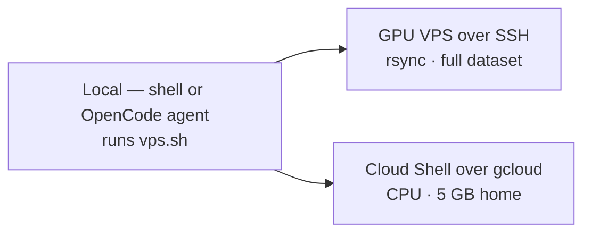

<div align="center">

# vps-agent

### One command line to your remote training box.

One wrapper — **`vps.sh`** — for humans and OpenCode agents: sync data, launch
detached GPU training, stream logs, pull the model home.\
Over plain SSH or Google Cloud Shell. Never stores a secret.

    [](https://vpsagent.pages.dev)

**[Live walkthrough](https://vpsagent.pages.dev) · [Quickstart](#quickstart) · [Commands](#commands) · [Troubleshooting](#troubleshooting)**

</div>

<!-- keywords: vps-agent, remote training, ssh wrapper, gcloud cloud-shell, opencode agent, pytorch cuda, tmux -->

## How it works



The full run, five commands:

```bash
./vps.sh gpu                  # is there CUDA?
./vps.sh sync-data            # laptop -> remote, deduplicated
./vps.sh train -- --epochs 20 # detached; safe to close the terminal
./vps.sh logs -f              # stream v3.log; Ctrl-C detaches safely
./vps.sh pull-model           # weights + history back home, plots rendered
```

> [!NOTE]
> Connection comes from the environment — `VPS_USER`, `VPS_HOST`, `VPS_PORT`,
> `VPS_KEY`, `VPS_DIR`, `VPS_MODE`. Copy `.env.example` to `~/.vpsrc` and never
> commit real values. `doctor` prints connectivity only, never keys.

## Quickstart

Once per human + agent host.

### SSH VPS — GPU / full dataset

```bash
cp .env.example ~/.vpsrc   # edit with real host/key
source ~/.vpsrc            # or: export VPS_USER=... VPS_HOST=...
chmod +x vps.sh
./vps.sh doctor            # expect: local OK + remote line
```

One-time key setup per client:

```bash
ssh-copy-id -i ~/.ssh/id_vps user@host
```

`doctor` prints `local: … OK` plus `remote: user@host torch … cuda …`
(or `no-torch` if torch isn't installed yet). Config used in this mode:

```bash
VPS_MODE=ssh VPS_USER=ubuntu VPS_HOST=203.0.113.10 VPS_PORT=22 VPS_KEY=~/.ssh/id_vps VPS_DIR=~/jetdb
```

### Cloud Shell — no inbound SSH, no GPU

<details>
<summary>Setup for Google Cloud Shell (CPU only)</summary>

```bash
# once: install the gcloud CLI, then
gcloud auth login
gcloud cloud-shell ssh --authorize-session --command="echo ok"
# point vps-agent at it (no USER/HOST/KEY needed)
export VPS_MODE=cloudshell VPS_DIR=~/jetdb
./vps.sh doctor
```

> [!WARNING]
> Cloud Shell gives you a **5 GB persistent `$HOME`** — a full ~4.6 GB dataset
> barely fits, so sync a subset first. There is **no GPU** (CPU train, slow),
> and idle sessions can be reclaimed — `train` runs detached via `tmux`/`nohup`
> so `logs` can reattach later.

> [!TIP]
> For the full dataset plus GPU, use a GCE VM with a static IP instead —
> same tool, `VPS_MODE=ssh`.

</details>

## Requirements

| | SSH mode | Cloud Shell mode |
|---|---|---|
| Local tools | `ssh`, `rsync`, `python3` | `gcloud`, `python3` |
| Auth | SSH key on VPS (`ssh-copy-id` once) | `gcloud auth login` + authorized session |
| Remote | Python 3 + `torch` (CUDA optional) | Python 3 + `torch` (CPU only) |

## Commands

| Command | Does |
|---|---|
| `doctor` | Local deps + SSH/`gcloud` + remote `torch` check |
| `exec -- <cmd>` | Run anything on the remote, output back here |
| `put <local> <remote>` / `get <remote> <local>` | Single-file copy |
| `sync-data [--from]` | Sync dataset dirs, skipping dupes (`quick_jets`, `archive.zip`, `kaggle_full*`); `--from` pulls remote → `./vps_inbox/` |
| `gpu` | `nvidia-smi` + `torch.cuda.is_available()` (Cloud Shell reports no GPU) |
| `train [--epochs N]` | `combine_datasets.py` (fixes remote paths) + detached `train_v3.py` via `tmux`/`nohup` |
| `logs [-f]` | Last 30 lines of `v3.log`, or stream with `-f` |
| `pull-model` | Fetch `v3_jet.pt` + `history_v3.csv` home, then render plots |
| `help` | Print usage from the script header |

<details>
<summary>More examples — exec, put, get, reverse sync</summary>

```bash
./vps.sh exec -- nvidia-smi
./vps.sh put ./train_v3.py ~/jetdb/train_v3.py
./vps.sh get ~/jetdb/v3.log ./v3-remote.log
./vps.sh sync-data --from   # pull remote outputs into ./vps_inbox/
./vps.sh logs               # last 30 lines without following
```

</details>

## Data sync

<details>
<summary>Which directories sync, and how</summary>

Synced dirs (`DATA_DIRS` in `vps.sh`), relative to repo root:

```text
archive/sample_meta.csv sample_meta.csv esc50_tmp desed_train drone_audio
yt_flybys_5s yt_flybys2_5s yt_flybys3_5s abbotsford_5s f16_5s auto_5s
sonic_booms archive/audio
```

- SSH mode uses `rsync -av --progress`; missing local dirs print `skip missing: <dir>`.
- Cloud Shell mode has no `rsync` transport — falls back to `gcloud cloud-shell scp --recurse` per dir.
- Raw/staging dupes (`quick_jets`, `archive.zip`, `kaggle_full*`) are intentionally excluded.

</details>

## Security

- Secrets live only in env / `~/.vpsrc` — never in the repo.
- SSH uses `BatchMode=yes`, `StrictHostKeyChecking=accept-new`, 10 s connect timeout.
- `doctor` / `gpu` output carries no keys or paths beyond `VPS_DIR`.

## Troubleshooting

| Symptom | Fix |
|---|---|
| `set VPS_USER` / `set VPS_HOST` | `source ~/.vpsrc` first, or export the vars |
| `install gcloud CLI` | Install from <https://cloud.google.com/sdk/docs/install>, then `gcloud auth login` |
| SSH hangs / timeout | Check `VPS_HOST`/`VPS_PORT`, security-group ingress, and try `ssh -p <port> -i <key> user@host` manually |
| `no-torch` from `doctor` | `pip install torch` on the remote (CPU wheel is fine for a connectivity check) |
| `no-nvidia-smi` from `gpu` | Expected on CPU-only hosts / Cloud Shell |

## Sharing

Commit this directory; teammates source their own `~/.vpsrc` pointing at the
same (or their own) remote. Nothing host-specific is hardcoded.

Related: [`vps.sh`](./vps.sh) · [`.env.example`](./.env.example) · [interactive walkthrough](https://vpsagent.pages.dev)
